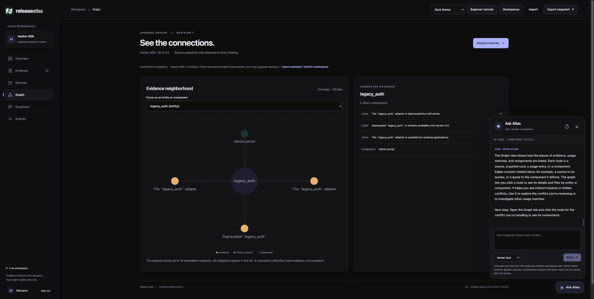

# Release Atlas

**Created by [Maryana Yurchyshyna](https://github.com/myurch).**

A collaborative workbench for reviewing software upgrade evidence. Bring versioned release notes and reference text, declare the APIs your application uses, inspect cited changes and conflicting guidance, and record a review with your team.

**Status: v0.1 local preview.** The Python service, responsive interface, analysis, retrieval, collaboration and contextual assistant are implemented and tested as described below. The Chromium CI suite covers live and standalone-file workflows; container execution remains unverified. This is not an enterprise security product or an upgrade-safety certification.



*The fictional Harbor SDK example: explore the `legacy_auth` evidence neighborhood, read its connected evidence, and get workflow guidance from Ask Atlas.*

## Hosted demo

[Open the interactive demo](https://maryanayurchyshyna.com/release-atlas/). Anyone with the link can explore it.

The hosted demo opens with the fictional Harbor SDK review already loaded. Explore the available pages, inspect evidence and graph connections, and try the beginner tutorial. Ask Atlas uses built-in **App guide** help. There is no live LLM connection, Python service, shared editing or new analysis on the demo site. Prepared tutorial decisions and answers are labeled as examples.

**Reset example** restores the sample review. Import and Export work in the current browser view; imported data is not sent to a backend. Refreshing returns to the original example. To run analysis, collaborate or use model chat, use the full application below.

`npm run build` produces both `dist/release-atlas.html` for the live service/file viewer and `dist/index.html` for static demo hosting. Serve the demo index through any static host. Its explicit build mode prevents API, session, event-stream and model requests even over HTTPS. The original live-service behavior is preserved.

## Try the application

Open `dist/release-atlas.html` in a modern browser and choose **Beginner tutorial** to learn with the included fictional Harbor SDK example. The file includes its JavaScript and CSS. This standalone mode can browse, import and export saved reviews. It cannot run Python analysis or synchronize with teammates. The UI keeps those technical mode details out of its main review workflow.

For the live workspace, use Python 3.14 and run these commands from this project directory:

```sh
python3 -m venv .venv
.venv/bin/python -m pip install -r requirements.txt
./start.sh
```

On the owner's Intel Mac, use `sh run-release-atlas-macos-intel.sh` from this checkout to launch the app with its working Python and local model configuration. The same `ATLAS_AUTH_ENABLED=1` setting works with this launcher.

Open http://127.0.0.1:8765. The live workspace opens directly, with sign-in disabled by default. Choose **Beginner tutorial** or add your own source. Changes are recorded as **Local reviewer**, so reviewers are not distinguished in this mode. Anyone who can reach the configured service can access and edit its reviews; keep the default loopback binding for local use.

To require the existing display-name and shared-code sign-in, restart with:

```sh
ATLAS_AUTH_ENABLED=1 ./start.sh
```

Read the generated `.atlas/access-code` locally and enter it with a display name. The code is generated once with owner-only permissions only when authentication is enabled, unless `ATLAS_ACCESS_CODE` supplies it. Existing codes are retained when sign-in is disabled. Sessions expire after 12 hours and reset on restart. Set `ATLAS_AUTH_ENABLED=0` or leave it unset to disable sign-in again. Only `0` and `1` are accepted. Startup loads the repository-root `.env`; `.env.example` is a safe template only. The tutorial remains available from the sign-in screen without an access code.

The server stores workspace data in `.atlas/workspace.sqlite3`. Do not commit or share that directory. `Ctrl+C` stops the server and closes its live-update streams; in-flight requests have a five-second graceful-shutdown window before cancellation. The workspace survives a restart. Ctrl+C affects the server in that terminal, not other independently launched instances.

Python 3.14.4 and Node 26 were exercised on macOS. Node 22+ is required only to rebuild the frontend, not to run the included HTML or Python server. Initial dependency installation requires network access; model weights are not included or downloaded by this project.

## Appearance

The generated atlas-and-route logo is embedded in the interface and favicon. Its original PNG and full generation prompt are in `assets/`. The **Appearance** selector offers System, Dark and Light. System follows the browser/host preference and defaults to dark when neither preference can be determined. A manual choice persists locally when browser storage is available. No appearance setting changes the workspace or other reviewers.

Dark mode uses neutral near-black surfaces, with a separate high-contrast light palette. Shared hover, press, focus, panel and feedback transitions make interactions visible. The interface respects `prefers-reduced-motion`.

The current workbench hides Questions, the Import/Export snapshot buttons and the Overview attention, usage-profile and topic panels. Their code and saved data remain intact for later re-enabling through `frontend/features.ts`. Topics remain available in Evidence, and questions can be asked through Ask Atlas. The tutorial skips hidden controls. Page footers and routine workspace status slogans have been removed. Earlier snapshot and Questions descriptions below document retained capabilities whose controls are currently disabled.

## Contextual help and Ask Atlas

Hover or keyboard-focus navigation, form fields, filters and actions for an explanation of what they do and why they matter. The small **?** controls beside key concepts also open help by click or keyboard. Escape dismisses help; the tooltip can be hovered and scrolled without disappearing.

**Ask Atlas** is available on every workbench page. It keeps a conversation as you move between Overview, Sources, Evidence, Graph, Questions and Activity. The wider reading panel uses a compact header and brief footer, with larger answer text. Page and selection context still inform requests; source citations and Retrieved context remain attached to each answer.

- **Model chat** uses the configured generation provider, defaulting to OpenAI `gpt-6-luna`, to explain the workflow, answer general questions or discuss retrieved evidence. Its responses include clickable evidence when appropriate. Check the underlying passages; model answers can still be wrong.
- **App guide** provides immediate built-in explanations without a model request. It is also available in the standalone HTML viewer. It does not pretend to generate answers about arbitrary evidence.
- **Use explicit assumptions:** Model chat follows requested source/version rules and answers hypotheticals, arithmetic and best-guess questions with labeled assumptions. A clarification that two statements concern the same batch, object or configuration supplies a premise for the calculation, even if the documents do not independently prove that connection. Later corrections replace earlier premises. Without an established connection, answers flag the missing link or remain conditional. It still cites opposing known conflict evidence and does not certify which source is objectively correct or whether an upgrade is safe.
- **Read sources before analysis:** Model chat can summarize saved source text even when there are no findings. Source citations expand to show the exact passage and open its original snapshot. Analyze sources is still needed for the NLP pipeline, passage cards, usage matching and the graph.
- OpenAI Model chat can propose **adding or deleting up to 30 sources in one batch** per message, within the 30-source workspace limit. Review the resolved title, version, permission notice, URL and text, then choose the button labeled **Add N sources** or **Delete N sources** inside chat. Every item is saved in one revision/audit transaction or none are saved. Nothing is saved until confirmation. Deletion removes dependent findings and saved answers and clears graph/topics, just as deletion on Sources does. Other edits, SQL, review decisions and saving shared answers are unavailable through chat. The read-only calculator remains available. Use **Questions** for answers that should become part of the review snapshot.
- For example, ask **“Delete all sources that mention apples.”** The server searches the full saved titles and source text, even with zero findings or partial chat retrieval. Matching is literal and case-insensitive: `apples` also matches `pineapples`. The preview shows the exact phrase and every affected title/version, with expandable full text and aggregate deletion consequences. It does not support regex, SQL wildcards or arbitrary semantic filters. No matches creates no proposal; an empty search never means all sources. For a batch creation, provide each source text separately and any metadata you want to set.
- Missing source fields default to the next `Source N` title among current numbered sources, version `1`, an empty URL, `User supplied; verify redistribution rights`, and `No source text supplied for <title>.` for absent text. These are placeholders, not verified version or license facts. Duplicate version/content pairs and workspace limits are still enforced. Ambiguous deletion requires clarification; the confirmation displays the exact source.
- Source proposals expire after ten minutes and are tied to the current session and workspace revision. Changes or workspace switches make old proposals unusable. Confirmation accepts an opaque server token and acknowledges the exact ordered source-ID manifest. It cannot alter retained source fields, targets or filters. Older clients that only acknowledge one source cannot apply a multi-source batch. App guide, saved-file views and the hosted demo cannot use source actions. Explicit Ollama and compatible providers remain text-only.
- Conversation is held only in the open browser view. Closing the panel or changing pages preserves it. Refreshing, signing out, importing a standalone snapshot or switching workspaces clears it. It is excluded from review exports. The tutorial hides and pauses live chat, preserving the conversation until you return.
- Enter sends a message; Shift+Enter adds a line. **Stop response** cancels waiting in this browser and keeps the question. A provider may finish its current call before another model request can start.

The server sends the selected page, workspace title, source titles/versions, declared usage, up to eight evidence excerpts, up to eight original source passages (16,000 Unicode code points of source text in total) and up to ten previous messages to its configured provider. No credentials or audit history are included. Requests and responses are bounded and revision-checked, and require a session when `ATLAS_AUTH_ENABLED=1`. Citations must belong to the supplied evidence; known conflict partners travel together, and answers citing just one side of a supplied conflict are rejected. Stale findings are excluded, while current saved source text remains readable. Source passages carry source IDs, hashes and exact Unicode positions; the server and browser validate source citation references. Known conflict checks apply to both finding and source citations. Ask Atlas uses hybrid passage retrieval: lexical and pretrained semantic similarity, exact technical entities, learned topic preferences and documentation-purpose classification. Selected context is a preference for relevant passages; explicit source/version restrictions narrow the search. Broad summaries and underspecified follow-ups use bounded source coverage. Open **Retrieved context** under an answer to inspect what was selected and why. A coverage warning is added when the source text does not all fit, so a partial summary is not presented as a complete review. Switching workspaces or losing the session prevents a pending result from being delivered. These checks do not establish semantic accuracy or eliminate prompt injection.

## Beginner tutorial

Choose **Beginner tutorial** in the toolbar, **Start beginner tutorial** in an empty workspace, or **Try the beginner tutorial** from the sign-in screen. The fifteen-step lesson starts with a concrete goal: decide what must be checked before upgrading the fictional Checkout service to Harbor 2.0.

The lesson explains sources, versions, claims, usage profiles, conflict candidates, review decisions, graphs, retrieval and citations in plain language. Its cursor moves to actual interface controls, clicks them and outlines the relevant result. **Next** advances at your pace. **Back** reconstructs the earlier example state; **Replay step** repeats the action. **Exit tutorial**, **Finish tutorial** or Escape returns to your previous screen, including unsaved form inputs. The tutorial uses prepared analysis and a labeled example answer. It does not write to the API, fetch feeds, call models or download exports.

Each lesson also includes **How this works**, connecting the action to the actual tooling and concept behind it. Examples include Python/scikit-learn NLP and NMF topics, TF-IDF/SVD statistical embeddings and logistic classification, technical entity extraction, NetworkX knowledge graphs, FastAPI/HTTPX data feeds, optional RAG/graph-assisted generation, Pydantic citation checks, TypeScript/React collaboration with SSE and SQLite, and evaluation against a keyword baseline. The explanations distinguish model suggestions from human decisions, explicit conflict rules from ML, and prepared tutorial outputs from live inference.

Reduced-motion preferences remove cursor travel and click animation. Tutorial controls remain visible while longer lesson text scrolls. Keyboard focus stays in the tutorial controls. A click/status caption describes actions without relying on the cursor alone.

The example conclusion is deliberately limited: investigate the two version 2.0 `retry_limit` passages, verify the supported setting and test retry behavior before proceeding. The 1.8 reference is historical context, and other findings still need review. A human review is not a certification of upgrade safety.

## Leave the example or switch workspaces

In a live workspace, choose **Workspaces**, enter a name, then **New empty workspace**. The previous review remains saved. Select **Open** beside it in the same chooser to return later. A saved synthetic example also shows **Leave example / switch workspace** next to its label. Existing databases migrate automatically, preserving their active review, sources, notes and history.

The service keeps up to 30 named workspaces. The active selection is shared with everyone connected to that server. Creating or switching closes unsaved form inputs in the current view; save notes before switching. Each workspace retains its own audit history, while revisions increase across all switches so outdated writes cannot land in a different workspace. There is no delete operation in this preview.

**Import** in the live interface creates a new saved workspace and preserves the previous one. If its title is already present, an `(import N)` suffix distinguishes it. In the standalone viewer, Import replaces only the current view after confirmation; use Export first to keep an unsaved imported snapshot. The tutorial itself never needs unloading from the server because its state is temporary.

## Review your own upgrade

1. Create a named workspace and add release notes or versioned reference text in **Sources**, including its version. The add-source form uses the default permission metadata, `User supplied; verify redistribution rights`, without requiring a license field.
   **Import mock data for demo purposes**, below Add Evidence in a live workspace, adds six original fictional documents: **LumenUI frontend** and **HarborAPI backend**, each at **1.0, 2.0 and 3.0**. The [readable corpus and example questions](data/demo-documents/README.md) cover shared routing/API contracts, security, authentication, pagination, retries, caching and live updates. One deliberate disagreement in the two 2.0 guides is corrected in frontend 3.0, making comparisons and human review useful. Each file is about 3–4 KB; all six together are about 20 KB of source text. These repositories are fictional and their `example.invalid` origins are labels, not live websites. Sources carry their actual numeric versions and original synthetic MIT provenance.
   The button imports from `data/demo-documents/` with no GitHub/model requests, preserving existing sources and drafts, skipping identical sources and saving the additions together in one guarded revision. Changed workspaces/sessions, invalid bundles and capacity failures save nothing. Choose **Analyze sources** afterward. Hosted, tutorial and saved-file views do not expose this live action; the existing prepared hosted review is unchanged. The individual **Fetch README** action still fetches public GitHub text and remains subject to GitHub limits. The old Pallets snapshots are retained only as licensed regression fixtures, not demo-button input. See [synthetic demo validation](validation/synthetic-demo-validation.md).
   The Sources page offers pasted text and public GitHub README fetching. The GitHub release-feed import form has been removed; the backend feed endpoint remains available.
   To import a public GitHub README, expand **Fetch a public GitHub README**, enter a repository URL such as `https://github.com/owner/repository`, then choose **Fetch README**. Review the fetched Source text, title and version, then choose **Save source**. After a successful save, the complete add-source draft and README URL are cleared; failed saves keep the draft. Fetching alone saves nothing. Existing text requires **Replace source text** or **Keep current draft**; existing title and version are kept. Blank title/version receive suggestions, with the fetched commit as the default version.
   Only public GitHub repository URLs are supported, not arbitrary websites, private repositories or individual file URLs. Atlas reads the default branch README at a pinned commit and uses its immutable file URL as the source origin. Missing/empty READMEs, unavailable repositories, API/network failures, timeouts and rate limits show actionable messages without changing the draft. READMEs over 12,000 Unicode code points are rejected without truncation; paste a smaller excerpt manually. Public visibility does not grant redistribution rights, so check your rights before sharing source text. The separate Source URL field remains a reference link and never fetches automatically.
   To remove a saved source, use the trash icon on the right of its card and confirm. Its findings, review decisions and saved answers citing those findings are removed. Other sources and their reviews remain. Analyze again to refresh the graph and topics. Deletion is available only in the live app.
2. In **Overview**, edit the usage profile with one `component | API_or_setting` pair per line, then **Analyze sources**.
3. Open **Evidence**, compare exact passages and follow source links. Category and usage matches are suggestions. Investigate conflicts before deciding.
4. Use **Graph** to follow a component to its settings and claims. In **Questions**, compare keyword, embedding and graph retrieval; the optional model checkbox drafts a cited answer.
5. Record a review decision and note. Other sessions receive updates. If a peer changes the workspace while you are writing, load the current review before saving again.
6. Check **Activity**, then **Export snapshot**. This JSON keeps sources, claims, graph, answers and review names together. Check its content and permissions before sharing.

Harbor SDK, all demonstration documents and training/evaluation examples are original synthetic fixtures, not advice about a real library. Imported names are provenance, not verified identity. Export preserves the current view, which can lag briefly during a reconnect; wait for the live connection before taking a final shared snapshot.

## Models and data flow

Generation defaults to **OpenAI GPT-6 Luna** at `https://api.openai.com/v1`. Ask Atlas Model chat and optional drafted answers call the Responses API with reasoning disabled, a strict JSON schema, bounded output and `store=false`. Local validation still rejects invalid citations, one-sided conflict citations in chat and stale workspace results.

The OpenAI adapter exposes the read-only `calculate` function and, only for Ask Atlas, `manage_source` with exactly two public actions: `add_sources` and `delete_sources`. Each accepts one or multiple sources in the same format. The source tool is exposed only for a current request to add or delete a source; unrelated edit requests receive no source tool. It prepares a validated batch on a workspace copy; a separate user confirmation applies it through revision-checked, audited persistence. The model never receives a database connection, SQL tool or confirmation token. Saved answers in Questions receive only the calculator. This follows the strict function-calling pattern in the [official OpenAI documentation](https://developers.openai.com/api/docs/guides/function-calling).

The calculator supports decimal sums, subtraction, multiplication, division, percentage changes and ordered quantity events. Consumption, removal and loss subtract nonnegative amounts; receipt and addition increase them. Tool arguments are schema-validated and citation IDs are restricted to supplied evidence. No Python expressions, shell commands, file access or network access can be executed by these functions. Up to three tool calls and four API requests share the original 90-second deadline; malformed arithmetic is returned as a bounded error for correction. Division and other nonterminating results are rounded to at most 12 decimal places and marked as rounded. Model interpretation of quantities, units, negation and assumptions still requires review. Explicit Ollama and compatible adapters retain their existing text-only behavior. The app does not request provider-side conversation storage; provider retention policies still apply.

New classification, topics, entity extraction and graph retrieval work without an LLM. App guide, tutorial and the static hosted demo never call OpenAI. Sources remain in the local SQLite database; the question, retrieved excerpts, source titles/versions and bounded chat context are sent to the configured provider. Original source passages are retrieved independently of findings, so Model chat can read saved text before analysis or when no findings exist. It does not inspect files on disk or automatically fetch reference URLs. The separate **Fetch README** action sends the validated repository name to GitHub through the Python service without provider credentials, then fills a local draft for review. It does not use a model or modify the workspace until Save source.

To use your OpenAI account:

1. Sign in to [OpenAI Platform](https://platform.openai.com/), select or create an API project for Release Atlas, and enable API billing. A ChatGPT subscription does not supply the application's API billing.
2. Set a project spend limit appropriate to your demo and create a project API key with permission to create Responses. Keep it private.
3. Copy `.env.example` to `.env` if you do not already have that file. Put your key after `OPENAI_API_KEY=` in `.env`, save it, and run `chmod 600 .env`. This local file is ignored by Git. Run `sh run-release-atlas-macos-intel.sh`; the launcher reads the saved key automatically. Without a saved key, its interactive hidden prompt still supplies a key for that run only. You can also use your server's secret environment. Never paste the key into Ask Atlas or tracked files.
4. Open the live app and choose Model chat in Ask Atlas. Save and analyze sources before asking about their evidence. If a request fails, the app distinguishes missing/rejected credentials, project permissions, unavailable models and billing/rate limits.

Settings are documented in `.env.example`. The Intel launcher, `./start.sh` and `python -m backend` automatically load `.env` from the repository root, independent of the working directory. Existing environment variables take precedence, including explicitly empty values. Restart after editing `.env`. Only single-line `ATLAS_*` and `OPENAI_API_KEY` assignments are accepted, with optional quotes, comments and `export`. Values are literal: shell commands, variable expansion and multiline values are not supported. The Intel launcher still forces loopback binding and matching origins. The default settings are `ATLAS_LLM_KIND=openai`, `ATLAS_LLM_BASE=https://api.openai.com/v1` and `ATLAS_LLM_MODEL=gpt-6-luna`. `ATLAS_LLM_KEY` can explicitly override `OPENAI_API_KEY`. Keys are never included in state responses, review exports or frontend assets. Chat and saved model answers share the evidence policy in `backend/prompts.py`. Their OpenAI structured-output schemas restrict citation IDs to the current supplied evidence; local citation validation still applies. The OpenAI provider requires the official API base to prevent sending its credential to another host.

Ollama remains available by explicit configuration:

```sh
ATLAS_LLM_KIND=ollama ATLAS_LLM_BASE=http://127.0.0.1:11434 ATLAS_LLM_MODEL=gemma4:12b sh run-release-atlas-macos-intel.sh
```

For another OpenAI-compatible Chat Completions service, set `ATLAS_LLM_KIND=compatible`, its `ATLAS_LLM_BASE`, model and optional `ATLAS_LLM_KEY`. Remote endpoints must use HTTPS. Compatible services retain the nonstreaming JSON subset and require separate validation. OpenAI Responses schema support is not assumed for other providers.

Embeddings are a separate contract. The visible Evidence pipeline and default Questions vector retrieval use TF-IDF with truncated SVD, a statistical latent semantic representation. Ask Atlas now has a separate local neural retrieval path described below. Setting `ATLAS_EMBED_MODEL` enables the separate `ATLAS_EMBED_KIND`, `ATLAS_EMBED_BASE` and optional `ATLAS_EMBED_KEY` adapter. It checks row order, count, finite nonzero vectors and dimensions. Vectors are rebuilt per query, so cached vectors from different models are never mixed. The historical Ollama endpoint returned HTTP 501 for embeddings. That result is separate from the successfully installed and tested local MiniLM encoder for Ask Atlas.

```text
Versioned Markdown / reStructuredText / release notes + optional declared usage
  -> immutable, hashed source snapshots
  -> structural blocks with heading paths and exact Unicode spans
  -> TF-IDF / 48-dimensional LSA embeddings / purpose classifier
  -> NMF subjects learned from prose + typed technical mentions
  -> passage/source/entity/component graph + separate release/conflict signals
  -> lexical, vector or graph-assisted evidence retrieval
  -> optional cited LLM answer + human review
  -> SQLite revision transaction + live SSE updates + portable JSON
```

## Ask Atlas: relevant context before generation

Ask Atlas indexes saved source text before constructing a model request, even when **Analyze sources** has not run or findings are stale. It sends selected exact passages, not all source bodies. The source inventory remains complete so inventory questions and confirmed source operations can still reference every saved source.

The retrieval pipeline combines:

- **Text analytics:** Markdown/RST structure, headings, subject-weighted TF-IDF matching and bounded exact-span windows. Generic question verbs such as configure do not by themselves retrieve unrelated setup text.
- **Embedding-based retrieval and classification:** the pretrained `sentence-transformers/all-MiniLM-L6-v2` encoder provides 384-dimensional semantic vectors. A logistic classifier is fitted to the 72 synthetic documentation-purpose examples using those vectors. Question-intent descriptions identify up to two plausible purposes; purpose agreement gives a modest preference, never a hard exclusion. The Evidence pipeline's separate LSA classifier remains unchanged.
- **Topic modeling:** NMF learns memberships over prose. Semantic comparisons with topic centroids provide modest boosts and limited expansion toward related members. Code does not define topics; sparse, repetitive or nonconvergent corpora skip the topic signal.
- **Technical entities:** exact normalized API, setting, command, endpoint, package and protocol matches. A small explicit terminology expansion is separately labeled and is not claimed as learned semantics.
- **Graph expansion:** a cached NetworkX graph connects passages through explicit references to uniquely identified source technologies and rare shared technical identifiers. After hybrid ranking, follow one entity bridge from up to three seed passages to add at most two otherwise unrepresented sources. The first four hybrid candidates keep priority. References require query relevance or corroborating seed context; shared identifiers require both. Generic hubs, command text and ambiguous names are excluded. Broad summaries and no-match requests retain their previous behavior.

Lexical, semantic, entity and terminology rankings are combined with reciprocal rank fusion. Topic and purpose signals are secondary. Highly overlapping source windows are deduplicated; known conflict partners are packed together within the existing bounds. Findings annotate retrieved spans instead of introducing a separate unrelated context path. Explicit source/version requests narrow selection, including saved commit labels and numeric highest-version rules; unorderable labels require a specific selection. A restriction that cannot be resolved does not broaden silently. Existing conflict citation checks remain strict when a restricted scope excludes opposing evidence.

For example, several highly ranked Flask passages can fill the context budget while only mentioning Jinja. Graph expansion can follow that reference to a relevant passage in a saved Jinja source, even when its body does not contain the question's backend/frontend words. It uses existing local embeddings and substantive shared terms to rank connected context. Exact references are labeled **technology reference**, not inferred dependencies or proof of integration. Source identities currently rely on distinctive leading titles such as `Jinja documentation` or repository titles such as `pallets/jinja README`; ambiguous titles and multiple sources claiming the same technology are skipped. Arbitrary titles may not resolve. Graph traversal respects source/version restrictions, exact citation validation, conflict packing and the existing eight-passage/16,000-character limit. It fetches no websites and performs no additional generation calls. The saved analysis graph data remains available to existing retrieval and snapshot code, independently of the replacement Graph display.

The in-memory index is bounded to three corpora and keyed by current sources and encoder identity; source changes invalidate it, while review-only changes can reuse it. Queries and rankings are computed per request. Recent user messages support simple deictic follow-ups; standalone questions do not automatically inherit earlier subjects. Retrieval remains heuristic, not general conversational reasoning.

Each model answer has **Retrieved context** with selected sources, exact passages, selection reasons, coverage and the active encoder. Graph additions also show the originating source, connecting identifier and relationship type. No-match questions receive an empty passage set instead of arbitrary source text. Broad summaries and subject-free questions such as “How many remain?” use bounded coverage. No result claims that source text proves a model answer true.

### Explore documentation relationships

**Graph** now shows a small circular map of project roles and evidence-backed relationships. Before a chat question, it explores saved source text. Send a **Model chat** question in Ask Atlas while on Graph to focus it on the full text of only that request's selected sources. Existing streaming supplies the source selection before the answer finishes. No extra retrieval or model request is made, and the Ask Atlas NLP/GraphRAG pipeline and model context are unchanged.

The separate `frontend/document-relations.ts` MVP identifies project names from repository README titles or leading title names, extracts eight kinds of documented capability with English rules, and combines question/capability matches with bounded, document-frequency-weighted lexical ranking. It recognizes a few explicit constructions such as “uses”, “depends on” and “began as a wrapper around”. It also links documents that independently describe a specific capability. Arbitrary keyword overlap never creates a capability or dependency edge. Explicit mention questions have a separate text-match mode described below. HTML markup, URL definitions, simple negations and ambiguous project references are excluded conservatively. Code is never executed or used to infer dependencies. Python/pycon/py fenced examples can supply exact language-tag and route-decorator evidence for Python and routing questions. This is a narrow rule-based extractor, not general language understanding, a new embedding model or calibrated confidence scoring.

Up to **six project/source nodes and eight connections** are arranged around the question in a fixed circular SVG layout. Select a project or numbered connection to highlight it and read exact Unicode source quotes, version and origin via **Open source**. The readable connection list mirrors the diagram. Solid links denote explicit statements, with historical wording preserved; dashed links denote shared capabilities; dotted links denote literal text mentions. Shared capabilities and mentions do not establish integration or dependencies. Empty matches remain empty instead of receiving weaker invented links. The circle is deterministic and static, with keyboard controls, theme support and horizontal scrolling on narrow screens.

With the bundled demo READMEs, “How do I make a backend and frontend?” shows Flask's historical wrapper links to Werkzeug and Jinja, Jinja/Quart template rendering and Jinja/MarkupSafe HTML escaping. A command-line question focuses on Click without inventing a cross-project connection. “How do I add routing?” recognizes Werkzeug prose and Flask/Quart route examples. “Which ones use Python?” recognizes documented Python usage across the six demo READMEs, including MarkupSafe's pycon example. This does not claim that an entire project is implemented in Python. These focused questions require direct capability evidence; Python links are limited to a sparse connecting forest rather than a full clique. Limited documentation can leave roles without links, or no map at all. **Show documentation overview** returns to all saved documents. The question map remains available across navigation, with the existing workspace/revision/user/request guards intact. Supporting passages sent to the answer remain visible in chat's **Retrieved context**.

“Which mention HTTPS?” and similar mention/reference/contain questions use `frontend/source-mentions.ts`, a general bounded literal matcher rather than a growing list of special-case capabilities. It searches the full selected source bodies, including URLs and code, and shows exact context quotes. Matching is case-insensitive with word boundaries, supports quoted phrases and up to three terms with simple and/or handling, and forms sparse links labeled **Both mention …**. It does not search source metadata or execute/interpret markup. Generic source titles remain eligible. With the bundled data, HTTPS matches all six READMEs, primarily through links; that is not proof of HTTPS support.

If a single unquoted term has no literal match but the capability rules find related evidence, the graph explicitly labels that fallback. The bundled READMEs contain no literal “security”, so that question shows Jinja/MarkupSafe HTML-escaping evidence with a **No literal mention** notice. Quoted/exact-term requests stay literal, and unsupported negative mention filters show a limitation notice instead of returning positive matches. All matching remains confined to the existing selected sources, with no additional Ask Atlas calls or changed retrieval behavior.

The previous linear keyword map and legacy evidence-neighborhood renderer, their exclusive styles and obsolete display tests were removed. Saved graph contracts, backend NetworkX retrieval, chat telemetry validation and stream/state handling remain intact. Hosted demos, tutorials and saved files inspect local data only. No visualization calls a model, network endpoint or database. See [relationship map validation](validation/relationship-map-validation.md), including the required passing cleanup checkpoint before MVP implementation.

### Local semantic setup

On the Intel Mac, install once after the main application installer:

```sh
sh install-release-atlas-semantic.sh
sh run-release-atlas-macos-intel.sh
```

The semantic encoder has been installed and tested on the owner's Intel Mac. It uses an isolated project-local Python 3.11 environment with ONNX Runtime and Tokenizers; the application keeps Python 3.14 for its SQLite security APIs. Model weights are about 86 MiB. Dependencies, Python, weights and the Apache license stay under Git-ignored `.tools/semantic/`, excluded from container builds. Setup downloads a fixed public model revision with pinned file hashes. Chat performs no encoder downloads, opens no additional port and sends no source text to an embedding service. Source text reaches only the private local worker and the configured generation provider's selected context. The encoder receives no provider keys.

`ATLAS_RETRIEVAL_ENCODER=auto` is the default. Set it to `statistical` to disable the optional worker. Missing or failed models produce an explicitly labeled TF-IDF/LSA fallback with weaker synonym coverage; they do not silently claim neural retrieval. `ATLAS_RETRIEVAL_PYTHON` can select a compatible interpreter for the fixed worker script. The worker uses overlapping 256-token windows with masked mean pooling and normalization, bounds input/output and times out after 90 seconds. It is stopped before server connection shutdown, including while encoding is active.

A real local 12-question probe checked keyword-free authentication passages, exact settings, API names, configuration, sign-in expiry, setup, follow-ups, subject changes, no-match behavior and summaries. Required direct-support checks pass, including wordless authentication retrieval with manual terminology expansion disabled. Mean recall@3 is **0.95**, equal to the small legacy baseline; one paraphrase misses a secondary relevant password/session passage while retrieving the direct answer. Some related but indirect passages can still be selected. This is a small synthetic test, not a production benchmark or a guarantee about generated answers. First-run initialization was about five seconds on this fixture, with warm selections around 0.07–0.09 seconds. Larger corpora can take longer. See the [retrieval validation record](validation/hybrid-retrieval-validation.md).

The graph regression probe, `.venv/bin/python tools/graph_retrieval_probe.py --local-model`, compares the same queries with expansion enabled and disabled. The synthetic Flask/Jinja case recovers Jinja in both local neural and statistical modes, preserving the first four results and excluding an unrelated garden source. All 12 earlier retrieval fixtures return the same passages and order in both modes. This does not establish general accuracy or answer correctness. See [graph retrieval validation](validation/graph-retrieval-validation.md); no browser or generation API evaluation was performed.

## Inspect the documentation NLP pipeline

Save documentation in **Sources**, choose **Analyze sources** to open the results in **Evidence**. The Overview links directly to the pipeline. Four numbered stages share the passage list:

1. **Text analytics** builds a document map with section paths, passage types, word counts and code-block counts. Markdown and reStructuredText headings, wrapped paragraphs, continued list items, fenced/indented code and tables receive structural treatment. Long prose is split at bounded sentence/space boundaries; code and tables stay intact. Link definitions, standalone images and heading adornments are not passage cards. Original text is never normalized or executed.
2. **Embedding classification** suggests documentation purposes: installation, configuration, API reference, examples, troubleshooting, security, migration, overview and resources. A local TF-IDF/SVD model produces normalized 48-dimensional LSA embeddings, followed by logistic regression trained on 72 original synthetic examples. Weak or uncovered inputs receive **other**. A passage's **Inspect NLP classification and entities** panel shows its top three labels, model scores and two nearby training examples with cosine similarity. Similar examples explain proximity, not causal feature attribution. This is a statistical embedding baseline, not a pretrained neural model. The existing release-note classifier remains a separate **Release signal** filter.
3. **Topic modeling** learns up to four NMF subjects from varied prose, excluding code and URL strings. It shows actual top terms with relative weights, representative passages and source coverage. A topic selection filters actual membership, not a keyword search. Sparse/repetitive inputs receive no topics; no topics are forced merely to fill a dashboard. Membership strength is a normalized factor weight, not a probability.
4. **Technical entities** provides a searchable typed inventory of APIs, configuration keys, commands, endpoints, imported packages, protocols/formats and other identifiers. Original case, Unicode positions and the matching rule remain visible. Separate normalized keys support matching; syntax-based types are candidates, not verified API contracts.

Section, purpose, topic and entity selections combine with text search and review scope. Clear individual filters or all pipeline filters. Selecting a representative passage opens its exact quote. Every passage retains its source/version and review controls. Reanalysis retains a human review only when the exact passage identity survives; changed grouping can create new identities. Existing snapshots remain readable, with a prompt to reanalyze when they lack pipeline metadata. Fetching a README still requires a separate Save source before analysis.

**Methods and limits** shows the model's held-out synthetic benchmark: purpose macro-F1 **0.88**, keyword baseline **0.85**, over **27 examples**. One security example was left as other. Training/evaluation wording is separate but shares an author and domain; there is no claim of repository-held-out or production accuracy. The UI records these metrics with the analysis. The legacy release-label fixture remains separately evaluated at macro-F1 1.0, equal to its keyword baseline. See the [pipeline validation record](validation/documentation-pipeline-validation.md).

The parser was inspected against the public [Werkzeug reference README](https://github.com/myurch/werkzeug/tree/8393ee88aaacf7bcd3a0b1d604511f70c222df25): 22 exact passages, four section paths, two intact code blocks and three discovered prose topics. The README was fetched only for inspection; it is not bundled or saved into user workspaces. Tests and demonstration documents remain original synthetic material.

GitHub import accepts only `owner/repository`, uses the fixed public GitHub release API, and snapshots up to three nonempty release bodies. Enter the content's license or your permission to use it. A public repository is not, by itself, permission to redistribute its content. The integration test exercised `tj/commander.js`; its release text is not shipped here.

## Capability evidence

| Capability | Working implementation | Evidence and limits |
| --- | --- | --- |
| Python NLP and text analytics | Structural Markdown/RST parsing, section map, word counts and exact spans | Tested with synthetic structures and the public Werkzeug README; bounded heuristic parser, not a complete document renderer |
| Embedding classification | Local normalized LSA embeddings and logistic purpose classifier, competing labels and nearest examples | 72 training / 27 synthetic evaluation examples; macro-F1 0.88 vs keyword 0.85; statistical baseline, not a neural encoder or calibrated confidence |
| Topic modeling | NMF over prose with weighted terms, representative passages and exact membership filters | Up to four topics; small/repetitive corpora may produce none; unsupervised subjects are distinct from predefined purposes |
| Technical entity extraction | Typed syntax rules, exact-case mentions, source offsets and searchable inventory | APIs/configuration/commands/endpoints/imports/protocols; bounded candidates, not general person/place NER or verified contracts |
| Knowledge graph/network analysis | Typed source/claim/entity/component links, degree and bounded traversal | Version-scoped conflict candidates and accessible neighbor lists |
| RAG / GraphRAG | Three comparable retrieval routes plus optional cited generation | Graph bridges retrieve claims for component names absent from the passages; not a universal graph advantage |
| APIs and data feeds | FastAPI JSON, GitHub release snapshots, OpenAI Responses and two local model protocols | Actual loopback HTTP, GitHub feed and both local generation routes exercised |
| TypeScript multiuser UI | React, SSE synchronization and retained draft revisions | Live browser tabs plus distinct API sessions; stale writes return 409 |
| Delivery and support | Locked dependencies, single HTML build, tests, launcher, container and CI recipes | Local rebuilds and hosted Chromium CI tested; Docker runtime remains unverified |
| Contextual assistance | `backend/assistant.py`, `frontend/Assistant.tsx`, `frontend/guide.ts` | Page-aware chat, confirmed source add/delete only, source reading independent of findings, exact citations, conflict-pair checks and built-in workflow fallback |

## Correctness and deployment boundaries

- Source text is immutable within its snapshot; SHA-256 and content identities are validated on import. Claim offsets use Unicode code points and must reproduce the exact quote. A source hash is integrity evidence, not an endorsement of its author or truth.
- Every write includes an expected revision. SQLite saves state and the latest 200 audit entries in one transaction. Long work checks the revision again before saving. The audit is bounded application history, not a tamper-proof compliance log.
- Adding sources or changing usage invalidates analysis. Reanalysis keeps reviews for stable claim IDs, recomputes suggestions and clears saved answers. Reviewers must reassess whether an earlier review remains appropriate after usage changes.
- Conflict detection is deliberately narrow: same exact semver-like version, shared identifier and opposing removal/support wording. It can miss negation, version ranges, synonyms and real-world nuance. No conflict found does not mean consistency or safety.
- Category scores are uncalibrated. Scores below 0.4 fall back to `other`. Even stronger scores can be wrong; the historical `legacy_auth` sentence illustrates limited contextual understanding. Human review remains necessary.
- The default is one loopback-bound Python worker with sign-in disabled. Anyone who can reach it can read and edit, and changes share the Local reviewer name. Set `ATLAS_AUTH_ENABLED=1` to require a shared passcode; all signed-in members can edit. Display names are not verified accounts. This is for local use and small trusted teams, not multitenant hosting.
- When authentication is enabled, sessions use HttpOnly/SameSite cookies. Host and write Origin are allowlisted in both modes. Source content renders as text. Provider URLs and secrets come only from server configuration. Model functions are limited to the calculator and confirmed source add/delete; there is no SQL interface, arbitrary code execution, browser-controlled URL proxy or repository mutation.
- Database inputs are validated and passed as bound parameters to fixed SQL statements. Code examples, quotes and SQL keywords remain exact inert source text; stripping or escaping their contents would break hashes and citations. Invalid Unicode and control characters (NUL, other C0 controls except tab/CR/LF, and DEL) are rejected, not silently rewritten. Request JSON must be an unambiguous UTF-8 object without duplicate keys, non-finite numbers or nesting beyond 64 levels. Unknown fields and existing size limits remain enforced. Write revisions are strict integers within SQLite's signed 64-bit range; workspace selectors are validated IDs.
- Runtime SQLite connections permit only the required reads/inserts/updates on the two workspace tables, transaction control and the three catalog functions. They deny schema changes, table-level deletes, attachment, unexpected functions and trigger/view-origin operations. Defensive mode is enabled, schema trust and extension loading are disabled, and SQLite resource limits are bounded. Only fixed startup migrations receive schema privileges. All saves revalidate the complete workspace inside an atomic transaction. These controls supplement [parameter binding](https://docs.python.org/3/library/sqlite3.html#sqlite3-placeholders) and [SQLite's hardening guidance](https://www.sqlite.org/security.html).
- Bounds: 30 sources, 12,000 code points per source, 300,000 source code points, 200 claims, 40 usage entries, 30 answers, 1.8 MB serialized workspace, 2 MB request/import, one analysis/query at a time, 40 event listeners and 100 sessions. Oversize analysis fails explicitly rather than truncating evidence.
- For remote or phone access, `localhost` names the device making the request. A phone must reach the host through a deliberately configured HTTPS reverse proxy. Enable `ATLAS_AUTH_ENABLED=1`, set the exact HTTPS `ATLAS_ORIGINS`, use `ATLAS_COOKIE_SECURE=1`, protect the data directory and keep one worker. Never expose Ollama publicly. Remote proxy deployment has not been tested here.
- Dependency versions are locked for reproducibility, not a permanent security guarantee. This preview is not an independent security audit.

Current validation includes 64 database-security tests, 30 batch-source tests and 68 README tests, with 352 Python tests and nineteen frontend checks in total, including 19 new documentation-pipeline Python cases. See the [database-security record](validation/database-security-validation.md) and [batch-source record](validation/source-batches-validation.md) for payloads, tested boundaries and limits. See the [README fetch validation record](validation/readme-validation.md) for automated failure cases and a real public GitHub fetch. Invalid controls in older data are rejected rather than silently altering source identities.

## Build and checks

Maintainer Git access uses the SSH remote `git@github.com:myurch/release-atlas.git`. SSH keys and identity selection stay in local machine/repository configuration and are not included in the project.

```sh
npm ci
npm run typecheck
npm run format:check
npm run build
npm test
.venv/bin/python -m pytest -q
.venv/bin/python tools/evaluate.py
.venv/bin/python tools/evaluate_documentation.py
```

`npm run build` regenerates the deterministic synthetic snapshot, bundles React/TypeScript/CSS, retains bundled legal notices and writes the live/file entry `dist/release-atlas.html` plus the isolated hosted demo `dist/index.html`. No external fonts, CDN scripts or image requests are required; the generated logo is embedded once. `ATLAS_PYTHON` can override the build's Python executable. The standalone file itself is editable HTML, but changes should normally be made in `frontend/` and rebuilt.

Optional integration checks:

```sh
.venv/bin/python tools/openai_probe.py # two billable OpenAI calls using synthetic evidence
.venv/bin/python tools/source_action_probe.py --live --batch --label my-run # thirteen billable synthetic source-tool tasks
.venv/bin/python tools/live_probe.py # historical local gpt-oss:20b adapters
.venv/bin/python tools/integration_probe.py
.venv/bin/python tools/shutdown_probe.py # real SIGINT/SIGTERM with an open live-update stream
.venv/bin/python tools/readme_probe.py --live # public GitHub README, no model calls or workspace changes
.venv/bin/python tools/retrieval_probe.py --local-model # installed local encoder, no generation API calls
npx playwright install chromium
npm run test:browser
```

The OpenAI probe reads the server environment or private `.env` and runs two model tasks against synthetic evidence only (calculator calls may add API requests); a successful run writes `validation/openai-results.json`. The local provider probe checks both historical `gpt-oss:20b` protocols. The integration probe uses an isolated workspace, real HTTP/SSE sessions and a public GitHub feed. The Playwright suite covers desktop/mobile, two contexts, export/import, direct file operation, keyboard help, motion preferences, assistant navigation, safe text rendering and stale chat suppression. It requires a working browser runtime. Shell-launched Chrome aborts in the original macOS sandbox, so the full suite runs in GitHub Actions on Linux; supported local Chrome interactions and module tests supplement that run. Safari/Firefox, real mobile hardware, WAN load and remote paid providers were not tested.

For opt-in paid prompt evaluation, run `PYTHONDONTWRITEBYTECODE=1 .venv/bin/python tools/assistant_eval.py --live --suite all --repeats 2 --label my-run`. It reads the private `.env`, requires GPT-6 Luna, and runs 98 model tasks over 49 synthetic scenarios (calculator rounds may add API requests, up to four per task) without opening or modifying saved user workspaces. Cases cover version rules, numeric comparisons, hypothetical assumptions, event-versus-snapshot arithmetic, calculator consumption/addition/negation/decimal cases, explicit linkage clarifications, carried-forward and withdrawn premises, missing facts, conflicts, history, code reading, partial context and document injection. Each report records the prompt hash, answers, validation results, token usage and a conservative cost estimate in `validation/assistant-eval-my-run.json`. The checks are outcome heuristics and need human inspection. Results do not guarantee correctness for arbitrary documents. See `validation/assistant-prompt-evaluation.md` for the research and acceptance criteria.

Recorded evidence lives in `validation/`. The legacy release-label evaluation ties its keyword baseline. The separate documentation-purpose evaluation modestly exceeds its baseline on a small synthetic corpus; neither establishes real-world superiority. Both real `gpt-oss:20b` adapters cited the two conflicting 2.0 passages and described the uncertainty. A valid citation ID alone cannot prove factual grounding. The reviewer is still responsible for reading the text.

Container recipe:

```sh
# Supply OPENAI_API_KEY in the shell environment first.
docker compose up --build
```

The default container also opens without sign-in. To enable it, add `ATLAS_AUTH_ENABLED=1` to the service environment in Compose and recreate the service; then read `/data/access-code` inside the container. Compose binds the published port to host loopback and keeps data in a named volume. `OPENAI_API_KEY` is forwarded from the Compose environment to the server. If explicitly switching back to Ollama, `host.docker.internal` refers to the host from the container. The container runs as UID 10001. Compose configuration was checked; the daemon was unavailable, so the image was not built or run. The CI workflow repeats the checks on GitHub; consult the repository Actions tab for its latest result.

## Troubleshooting and recovery

- **Cannot connect:** start `./start.sh`, use the printed port, and confirm no other process owns it.
- **Want sign-in:** set `ATLAS_AUTH_ENABLED=1` in the server environment and restart. Set it to `0` or leave it unset for direct access.
- **Invalid access code:** read the configured data directory's access-code file, or use your explicit `ATLAS_ACCESS_CODE` value. Restarting clears sessions, not the stored review.
- **HTTP 400/403:** the browser origin/Host must match `ATLAS_ORIGINS`. Do not solve this by allowing arbitrary origins.
- **HTTP 409:** refresh/load the current review. Preserve or copy your draft before replacing it. Do not blindly retry an old write with a new revision.
- **Model failure:** keep the evidence, check `OPENAI_API_KEY`, API project billing and model access, then restart with the intended server environment and retry. Rejected answers are not saved. Inspect sources directly while inference is unavailable.
- **Need another workspace:** use Workspaces to create an empty review or reopen an existing one. At the 30-workspace limit, existing reviews remain available; export needed snapshots, then stop the server and start with a different `ATLAS_DATA_DIR` for more space. Do not delete the original data directory.
- **Back up live data:** export through the UI/API or stop the server before copying `.atlas`. Do not copy an active SQLite main file alone while its WAL may contain newer transactions.

## Authorship and licensing

Release Atlas is an original personal project created by **Maryana Yurchyshyna** ([myurch](https://github.com/myurch)). The application-specific code and synthetic examples were developed for this project with AI coding assistance.

The original implementation and synthetic data are available under the [MIT license](LICENSE), copyright Maryana Yurchyshyna. Open-source dependencies retain their own authorship and licenses; bundled runtime credits are preserved in [THIRD_PARTY_NOTICES.md](THIRD_PARTY_NOTICES.md). The optional local [Sentence Transformers MiniLM model](https://huggingface.co/sentence-transformers/all-MiniLM-L6-v2) is Apache-2.0 licensed, pinned to revision `1110a243fdf4706b3f48f1d95db1a4f5529b4d41`, and is not bundled with the HTML. Its license is saved beside the locally installed weights. The AI-generated logo has a separate [provenance record](assets/logo-provenance.json).

Primary implementation references: [GPT-6 Luna](https://developers.openai.com/api/docs/models/gpt-6-luna), [OpenAI structured outputs](https://developers.openai.com/api/docs/guides/structured-outputs), [Ollama chat](https://docs.ollama.com/api/chat), [Ollama embeddings](https://docs.ollama.com/api/embed), [Ollama compatible API](https://docs.ollama.com/api/openai-compatibility), [scikit-learn decomposition](https://scikit-learn.org/stable/modules/decomposition.html), [GitHub releases API](https://docs.github.com/en/rest/releases/releases), [FastAPI](https://fastapi.tiangolo.com/).
